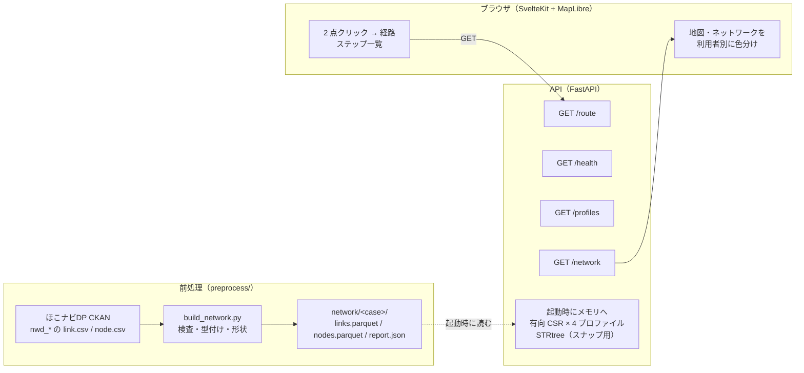

# API 設計書

Hokonavi Route Search API（歩行空間ネットワークデータによる歩行者経路探索）

| | |
|---|---|
| 版 | 0.2（2026-11-05・全 21 地区。1 プロセスで扱うのは HOKONAVI_CASE の 1 地区） |
| ベース URL | `http://127.0.0.1:8000`（開発）。画面からは同一オリジンの `/api`（Vite が剥がして渡す） |
| 形式 | JSON / UTF-8（500 バイト以上は gzip） |
| 認証 | なし |
| 自動生成仕様 | FastAPI の `/docs`（Swagger UI）・`/openapi.json` |

**公開版（GitHub Pages）はこの API を使わない**。同じ判断（`api/profiles.py`）の結果を静的 JSON に書き出し、
ブラウザ（`web/src/lib/routing/`）が同じ手順で探索して、`/route` と同じ形の結果を作る（README「2 つの動かし方」）。

---

## 0. 構成図



---

## 1. エンドポイント

### 1-1. `GET /health`

グラフを読めているか。読めていなければ `status: "error"` と `error` に理由。

```json
{"status": "ok", "graph_loaded": true, "uptime_seconds": 0.1, "case": "shibuya_sendagaya_shinjuku",
 "title": "東京都渋谷区・渋谷駅、千駄ヶ谷駅周辺／東京都新宿区・新宿駅周辺",
 "sources": [{"dataset": "nwd_shibuya_sendagaya_shinjuku", "title": "歩行空間ネットワークデータ（…）", "publisher": "国土交通省",
              "license": "公共データ利用規約(第1.0版）", "license_url": "…", "data_updated": "2021/05/26", "url": "…"}],
 "links": 7921, "nodes": 7155, "floors": [-1.0, -0.5, 0.0, 0.5, 1.0],
 "components": {"walk": 1, "wheelchair": 503, "stroller": 424, "vision": 1}, "load_seconds": 0.06}
```

`sources` は元の地区（まとめた地区でリンクを採ったもの）で、公共データ利用規約の出典表示に使う（画面の地図右下に出す）。

### 1-2. `GET /profiles`

利用者の一覧。`key` は `walk` / `wheelchair` / `stroller` / `vision`。

### 1-3. `GET /network`

表示用のネットワーク（GeoJSON FeatureCollection・LineString）。プロパティ:

| キー | 内容 |
|---|---|
| `link_id` `kind` `label` `distance` | ID・種類（`walk` `crosswalk` `stairs` `elevator` …）・表示名・距離 m |
| `floor` `floor_end` | 起点・終点の階 |
| `width` `slope` `lev_diff` `signal` `brail_tile` `elevator` `roof` | コードを文言にしたもの（空欄は null） |
| `direction` | 1 両方向 / 2 起点→終点のみ / 3 終点→起点のみ / 99 不明 |
| `acc_<プロファイル>` | 0 通れる / 1 属性が不明 / 2 片方向のみ / 3 通れない |

### 1-4. `GET /route`

| パラメータ | 型 | 既定 | |
|---|---|---|---|
| `from_lat` `from_lon` `to_lat` `to_lon` | float | 必須 | 日本の範囲外（緯度 20〜46・経度 122〜154）は 422 |
| `profile` | `walk` `wheelchair` `stroller` `vision` | `walk` | |
| `from_floor` `to_floor` | float | なし | 指定するとその階のリンクにだけ寄せる |

到達できないときも **200** で `geometry: null`・`unreachable_reason` に理由。

```json
{
  "profile": "wheelchair",
  "snap": {"origin": {"lat": 35.69, "lon": 139.69, "dist_m": 69.0}, "dest": {"lat": …, "lon": …, "dist_m": 49.0}},
  "unreachable_reason": null,
  "geometry": {"type": "LineString", "coordinates": [[139.69, 35.69], …]},
  "summary": {"dist_m": 2016.8, "time_s": 2207, "link_count": 94,
              "stairs": 0, "elevator": 1, "escalator": 0, "crosswalk": 14, "crossing": 3},
  "steps": [
    {"kind": "walk", "label": "歩道", "turn": "start", "dist_m": 324.0, "time_s": 324,
     "floor_from": 0.0, "floor_to": 0.0, "coord_start": 0, "coord_end": 12, "link_ids": ["…"],
     "instruction": "歩道を324m進む"},
    {"kind": "crosswalk", "turn": "slight_right", "signal": "信号あり・音響設備あり（押しボタンなし）",
     "instruction": "右斜め前へ、横断歩道を渡る（25m・信号あり・音響設備あり（押しボタンなし））", …},
    …,
    {"kind": "arrive", "instruction": "目的地に到着", …}
  ],
  "warnings": ["出発地の近くに車いすで通れる道（ほかの道とつながるもの）がないため、69m離れた道から案内します"],
  "elapsed_ms": 2.9
}
```

`coord_start` / `coord_end` は `geometry.coordinates` の添字。画面はステップにマウスを乗せるとその区間を強調する。

| `unreachable_reason` の例 | 起きるとき |
|---|---|
| 出発地の50m以内に、車いすで通れる歩行空間ネットワークがありません | ネットワークの外をクリックした |
| 出発地と目的地が、車いすで通れる道ではつながっていません | 200 m まで広げても同じ連結成分に乗らない |
| 車いすで通れる経路が見つかりません | 同じ成分だが一方通行で行き止まり |

---

## 2. 探索の中身

1. **コスト**（`api/profiles.py`）: リンクごとに 起点→終点 / 終点→起点 の 2 方向で `cost = 所要時間 × 係数`、通れない向きは `inf`
2. **スナップ**（`graph.py`）: STRtree で半径内のリンクを拾い、連結成分ごとに最寄り 1 本を候補にする。出発地と目的地が同じ成分に乗る組のうち、スナップ距離の和が最小のもの
3. **仮ノード**: スナップした点を S・T として、リンク両端への部分エッジ（コストは割合で按分）を足す。同じリンク上なら S→T の直行も足す
4. **Dijkstra**（scipy、有向）。並行エッジは csr_matrix が合計してしまうので、先に最小のものだけ残す
5. **案内**（`guidance.py`）: 種類が変わるところ・60° 以上曲がるところでステップを区切る。5 m 未満の歩く区間は前にまとめる。エレベーターは乗り通しで 1 ステップ

---

## 3. 技術選定（ksj-route-search-api との違い）

| | ksj-route-search-api | 本リポジトリ | 理由 |
|---|---|---|---|
| グラフ | 無向・全国 388 万リンク | **有向**・1 地区 1,866 リンク | 一方通行と勾配の向き |
| スナップ | 最寄りノード（KDTree） | **最寄りリンク上の点**（STRtree） | 歩行者のリンクは短いが、交差点間の長い歩道もある。ノードに寄せると行き過ぎて戻る |
| 重み | 時間 / 距離 × 高速あり/なし | **利用者 4 種** | バリアフリー属性で通れる道が変わる |
| 表示 | PMTiles + setFeatureState | GeoJSON（`/network`） | 1 地区なら十分小さい。全地区で PMTiles に移す |
| DB | PostGIS（ブックマーク） | なし | 今は保存する物がない |
